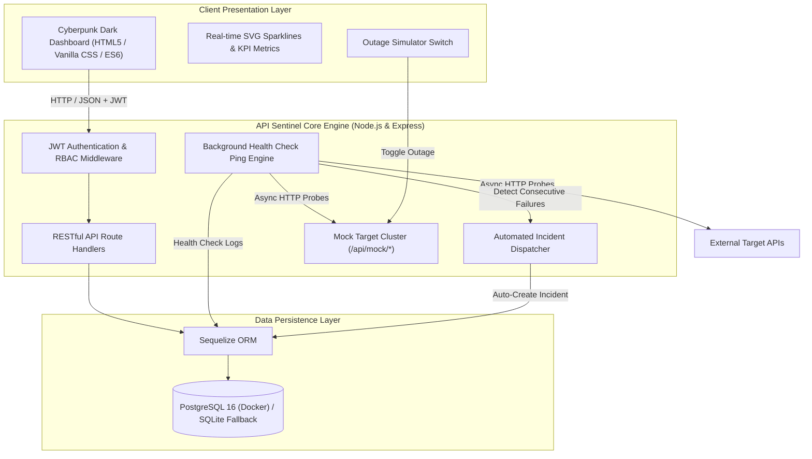

# 🛡️ API Sentinel — API Health Monitoring & Incident Management Platform

[](https://nodejs.org/)
[](https://expressjs.com/)
[](https://sequelize.org/)
[](https://www.postgresql.org/)
[](https://www.docker.com/)
[](LICENSE)

**API Sentinel** is an enterprise-grade API health monitoring, automated telemetry tracking, and incident command platform. Designed for Site Reliability Engineers (SREs), DevOps teams, and platform developers, Sentinel performs high-frequency health probes, visualizes real-time latency sparklines, automatically detects failures, and orchestrates end-to-end incident resolution workflows.

---

## 🏛️ System Architecture



---

## ✨ Key Features & Requirements Matrix

| Requirement | Implementation Detail | Status |
| :--- | :--- | :---: |
| **Database & Relational CRUD** | Full CRUD on Monitors, Incidents, Alert Rules, HealthCheck logs, and Users using Sequelize ORM. | ✅ Complete |
| **Search, Filter & Validation** | Search by name/URL/code; filter by health status, environment, severity; payload validation via `express-validator`. | ✅ Complete |
| **Authentication & RBAC** | JWT tokens with `bcryptjs` hashing. Distinct permissions for **Admin** (full management), **Analyst** (operational triage), and **Viewer**. | ✅ Complete |
| **Background Ping Engine** | Autonomous scheduler pings active endpoints, measures latency, calculates rolling uptime %, and records telemetry. | ✅ Complete |
| **Automated Outage Detection** | Triggers an active Incident with severity rating and timeline entry upon consecutive health check failures. | ✅ Complete |
| **Incident Management** | Full lifecycle: `Investigating` ➔ `Identified` ➔ `Monitoring` ➔ `Resolved` with root cause tracking and activity logs. | ✅ Complete |
| **Git & Version History** | Clean repository history, descriptive semantic commits, `.gitignore`, and tagged releases (`v1.0.0`). | ✅ Complete |
| **Docker Deployment** | Production multi-stage `Dockerfile` + `docker-compose.yml` with persistent PostgreSQL volume. | ✅ Complete |
| **Postman Test Suite** | Ready-to-import Postman Collection & Environment with pre-request scripts, test assertions, and token auto-injection. | ✅ Complete |
| **Live Outage Simulator** | Built-in 1-click toggle to simulate an outage on a target microservice for live exam demonstrations. | ✅ Complete |

---

## 🚀 Quick Start Guide

### Option 1: Docker Compose (Recommended for Evaluation)

Ensure Docker Desktop is running, then execute:

```bash
docker compose up --build
```

- **Web Dashboard**: [http://localhost:3000](http://localhost:3000)
- **PostgreSQL Database**: Port `5432` (Persistent volume: `sentinel_postgres_data`)
- **Healthcheck Probe**: `http://localhost:3000/healthz`

To stop the containers:
```bash
docker compose down
```

---

### Option 2: Local Run (Node.js & SQLite/Postgres)

Prerequisites: Node.js v18+ installed.

1. **Install dependencies:**
   ```bash
   npm install
   ```

2. **Configure environment:**
   ```bash
   cp .env.example .env
   ```
   *(By default, `.env` runs in SQLite mode with zero external dependencies needed!)*

3. **Seed database with test data:**
   ```bash
   npm run seed
   ```

4. **Start the application:**
   ```bash
   npm start
   # Or for hot-reloading:
   npm run dev
   ```

5. Open your browser at **[http://localhost:3000](http://localhost:3000)**.

---

## 👥 Pre-Seeded User Accounts

The platform includes pre-configured accounts representing standard SRE organizational roles. You can switch between them in 1-click from the top-right header:

| Role | Email | Password | Permissions |
| :--- | :--- | :--- | :--- |
| **Admin** | `admin@apisentinel.dev` | `Admin@123` | Full access. Create, edit, delete monitors; manage alert policies; full incident control. |
| **Analyst** | `analyst@apisentinel.dev` | `User@123` | Create monitors, trigger manual pings, acknowledge and resolve incidents, add timeline notes. |
| **Viewer** | `viewer@apisentinel.dev` | `Viewer@123` | Read-only telemetry monitoring and metrics inspection. |

---

## 📚 REST API Reference

### 🔐 Authentication (`/api/auth`)
- `POST /api/auth/login` — Authenticate and receive signed JWT Bearer token
- `POST /api/auth/register` — Register a new platform user with validation
- `GET /api/auth/me` — Return current authenticated user profile
- `GET /api/auth/users` — List platform engineers for incident assignment

### 📡 Monitors & Health Probes (`/api/monitors`)
- `GET /api/monitors` — List monitors (supports `search`, `status`, `environment`, `sortBy`)
- `GET /api/monitors/:id` — Retrieve monitor details with last 30 health checks and incidents
- `POST /api/monitors` — Register a new monitored endpoint *(Admin / Analyst)*
- `PUT /api/monitors/:id` — Update monitor configuration *(Admin)*
- `DELETE /api/monitors/:id` — Delete monitor *(Admin)*
- `POST /api/monitors/:id/ping` — Trigger immediate health check probe
- `POST /api/monitors/ping-all` — Trigger immediate ping on all active endpoints

### 🚨 Incident Command (`/api/incidents`)
- `GET /api/incidents` — List incidents (supports `status`, `severity`, `monitorId`, `search`)
- `GET /api/incidents/:id` — Retrieve incident details and full audit timeline
- `POST /api/incidents` — Manually report a new incident
- `PUT /api/incidents/:id` — Update incident details
- `POST /api/incidents/:id/acknowledge` — Acknowledge and assign incident
- `POST /api/incidents/:id/timeline` — Append progress update to incident timeline
- `POST /api/incidents/:id/resolve` — Mark resolved with root cause & mitigation notes
- `DELETE /api/incidents/:id` — Delete incident *(Admin)*

### 📊 Telemetry & System (`/api/health-checks`)
- `GET /api/health-checks` — Stream paginated health check logs
- `GET /api/health-checks/stats` — Aggregated uptime %, average latency, and check counts
- `GET /api/health-checks/system` — Diagnostic probe (DB dialect, memory, node version)

### 🔬 Mock Targets & Simulator (`/api/mock`)
- `GET /api/mock/healthy` — Returns fast 200 OK (simulate healthy API)
- `GET /api/mock/slow?delay=1200` — Returns delayed 200 OK (simulate degraded latency)
- `GET /api/mock/flaky` — Alternates between 200 OK and 500 error
- `GET /api/mock/service-target` — Target controlled by outage toggle
- `POST /api/mock/toggle-outage` — Toggle simulated failure state (`{ "active": true|false }`)

---

## 🧪 Postman Collection & Testing Guide

A complete Postman test suite is provided in the repository root:
- [`API_Sentinel.postman_collection.json`](file:///d:/Mini%20Project%20Micro/API_Sentinel.postman_collection.json)
- [`API_Sentinel.postman_environment.json`](file:///d:/Mini%20Project%20Micro/API_Sentinel.postman_environment.json)

### Importing into Postman:
1. Open Postman ➔ Click **Import**.
2. Select both `API_Sentinel.postman_collection.json` and `API_Sentinel.postman_environment.json`.
3. Select the **API Sentinel Local Environment**.
4. Run request **`🔐 Authentication ➔ 1. Login as Admin`**.
   *The test script automatically extracts the JWT token and saves it to the `{{token}}` variable!*
5. Execute any monitor, incident, or telemetry requests seamlessly.

---

## 🎬 Step-by-Step Live Demonstration Script

Follow this script during project presentation or evaluation:

1. **Start the Application**:
   Run `docker compose up --build` or `npm start`.
2. **Access Dashboard**:
   Open `http://localhost:3000`. Point out the dark-mode aesthetic, radar pulse indicator, and real-time KPI metrics.
3. **Demonstrate CRUD**:
   - Click **"+ Add Monitor"** and add a new endpoint (e.g., `Notification Worker`, `http://localhost:3000/api/mock/healthy`).
   - Click **"Ping Now"** on the card and watch the latency sparkline and 200 OK status appear immediately.
   - Edit the endpoint or delete it.
4. **Demonstrate Role-Based Access Control**:
   - Use the **Role Switcher** in the top navigation to switch between **Admin** and **Viewer**.
   - Notice that administrative actions (delete buttons, alert policies creation) are hidden/protected for read-only roles.
5. **Demonstrate Outage Simulation & Automated Incident Response**:
   - Navigate to the **Simulator & Diagnostics** tab.
   - Flip the **Simulate Outage** switch to **ON**.
   - Notice the `Order Processing Pipeline` status immediately transitions to **DOWN (503)**.
   - Switch to the **Incident Command Center** tab: Sentinel has automatically created a new incident titled `Service Outage: Order Processing Pipeline is DOWN`!
   - Click **Acknowledge** ➔ Click **+ Add Update** to log investigation notes ➔ Flip outage switch **OFF** ➔ Click **Mark Resolved** and record the root cause.
6. **Verify Docker & Database Status**:
   - Run `docker compose ps` to show healthy container status for `sentinel_app` and `sentinel_postgres`.
   - Show the persistent storage volume `sentinel_postgres_data`.
7. **Verify Git History**:
   - Run `git log --oneline` to display the structured commit history.

---

## 📄 License
This project is licensed under the MIT License — see the [LICENSE](LICENSE) file for details.
